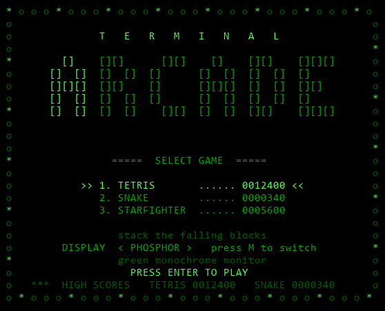
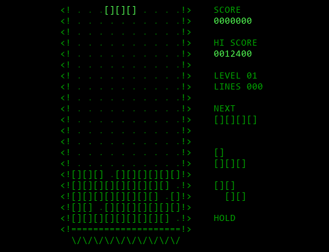
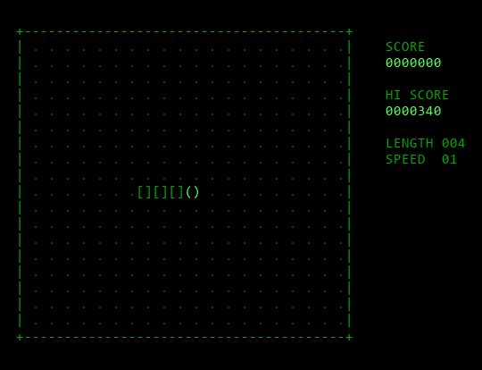
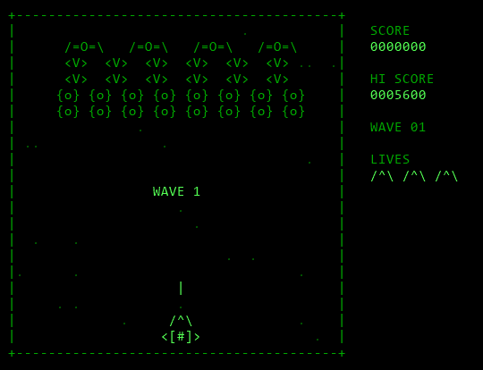
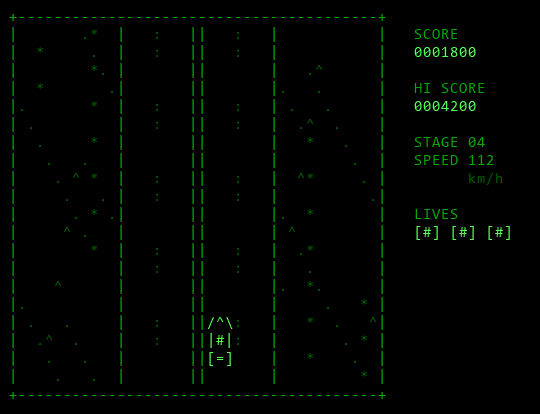

# Terminal Arcade

Retro arcade games in your terminal, in pure ASCII. Boot it up, pick a cartridge, play.



## Games

<table>
  <tr>
    <td align="center" width="50%">
      <br>
      <b>Tetris</b><br>
      <sub>Stack the falling blocks. SRS rotation, 7-bag, hold, 3-piece preview.</sub>
    </td>
    <td align="center" width="50%">
      <br>
      <b>Snake</b><br>
      <sub>Eat, grow, don't bite yourself. Speeds up as you go.</sub>
    </td>
  </tr>
  <tr>
    <td align="center" width="50%">
      <br>
      <b>Starfighter</b><br>
      <sub>Galaxian-style shooter. Hold the line against a swarm that dives at you.</sub>
    </td>
    <td align="center" width="50%">
      <br>
      <b>Road Fighter</b><br>
      <sub>Race a two-way road: dodge oncoming cars, slow traffic, potholes and roadblocks. Every stage gets faster and busier.</sub>
    </td>
  </tr>
</table>

## Display modes

Press `M` anywhere to switch. Your choice is remembered.

- **PHOSPHOR**: a green monochrome monitor. What you control glows brighter.
- **CGA**: the 16-colour graphics adapter. Every piece, enemy, car and hazard gets its own colour, which makes the action easier to read.

## Controls

| | Controls |
|---|---|
| **Arcade** | `↑` `↓` select · `Enter` / `1`–`4` play · `M` display mode · `Q` quit |
| **Tetris** | `←` `→` / `A` `D` move · `↓` / `S` soft drop · `Space` / `W` hard drop · `↑` / `X` rotate clockwise · `Z` rotate counter-clockwise · `C` hold · `P` / `Esc` pause · `←` `→` / `0`–`9` starting level (title screen) |
| **Snake** | `←` `↑` `↓` `→` / `W` `A` `S` `D` steer · `P` / `Esc` pause |
| **Starfighter** | `←` `↑` `↓` `→` / `W` `A` `S` `D` fly · hold `Space` fire · `P` / `Esc` pause |
| **Road Fighter** | `←` `→` / `A` `D` steer · hold `↑` / `W` accelerate · hold `↓` / `S` brake · `P` / `Esc` pause |

In every game, `Q` on the pause screen returns to the arcade, `Esc` on a game's title screen goes back to the arcade, and `M` switches the display mode.

## Run

Requires Python 3.10+. No third-party packages (`requirements.txt` is intentionally empty).

```
python -m venv .venv
.venv\Scripts\python arcade.py
```

- `arcade.py tetris`, `arcade.py snake`, `arcade.py starfighter` or `arcade.py roadfighter` jumps straight into one game.
- `arcade.py --no-boot` skips the power-on screen.

The terminal must be at least 60×24. Built for Windows Terminal / PowerShell; macOS/Linux work too (`.venv/bin/python arcade.py`). High scores and settings are saved under `saves/`, one file per game.

## Tests

```
.venv\Scripts\python -m unittest
```

## Layout

```
arcade.py     entry point
engine/       shared: terminal, input, drawing, display modes, saves, scene loop
games/        one package per game: rules, scene, media/ (demo GIFs)
launcher/     boot screen, game menu, media/
tests/        unit tests
```

## License

[MIT](LICENSE) © 2026 Shreyas Pandey
