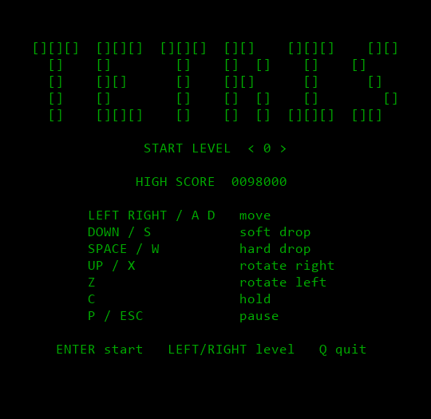

# Terminal Tetris

Terminal Tetris in pure ASCII.



## Controls


| Key                 | Action                         |
| ------------------- | ------------------------------ |
| `←` `→` / `A` `D` | Move                           |
| `↓` / `S`          | Soft drop                      |
| `Space` / `W`       | Hard drop                      |
| `↑` / `X`          | Rotate clockwise               |
| `Z`                 | Rotate counter-clockwise       |
| `C`                 | Hold                           |
| `P` / `Esc`         | Pause                          |
| `Q`                 | Quit (title, pause, game over) |

On the title screen, `←` `→` or `0`–`9` pick the starting level.

## Run

Requires Python 3.10+. No third-party packages (`requirements.txt` is intentionally empty).

```
python -m venv .venv
.venv\Scripts\python tetris.py
```

The terminal must be at least 48×24. Built for Windows Terminal / PowerShell; macOS/Linux work too (`.venv/bin/python tetris.py`).

## Rules

Standard modern Tetris: SRS rotation with wall kicks, 7-bag randomizer, 3-piece preview, hold, 0.5 s lock delay. Scoring is 100 / 300 / 500 / 800 × (level + 1) for 1–4 lines, plus 1 point per soft-dropped row and 2 per hard-dropped row. The level goes up every 10 lines.

## Tests

```
.venv\Scripts\python -m unittest
```

## Layout

```
tetris.py     entry point
src/          game logic, rendering, terminal and input handling
tests/        unit tests
docs/         gameplay GIF
```

## License

[MIT](LICENSE) © 2026 Shreyas Pandey
